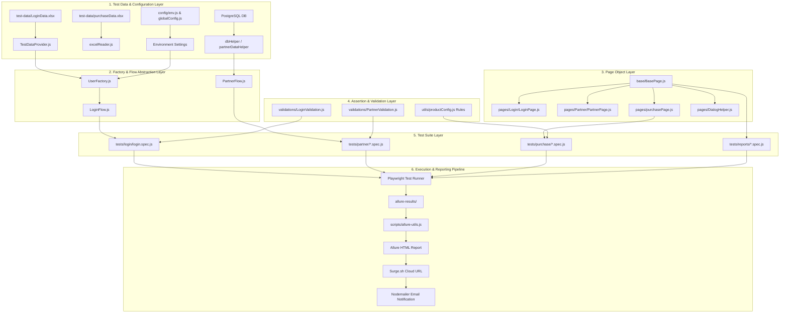
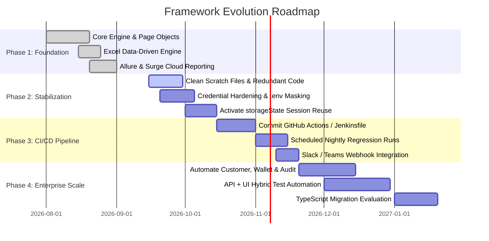

# Hi Busy – Web Automation Framework: Architecture, Technology Stack & Playwright vs Python Evaluation

**Document Title:** Enterprise Test Automation Framework Presentation  
**Target Audience:** QA Manager, Engineering Leadership, Technical Leads  
**Prepared For:** Hi Busy Subscription Management & Partner Portal Automation  
**Author:** QA Automation Engineering Team  
**Version:** 1.0  
**Status:** Implemented (Phase 1–2 Complete; Phase 3–5 In Progress & Recommended)

---

## Table of Contents

1. [Executive Summary](#1-executive-summary)
2. [Business Need & Problem Statement](#2-business-need--problem-statement)
3. [Automation Framework Overview](#3-automation-framework-overview)
4. [Technology Stack](#4-technology-stack)
5. [Framework Architecture](#5-framework-architecture)
6. [Project Structure](#6-project-structure)
7. [Design Patterns & Engineering Approach](#7-design-patterns--engineering-approach)
8. [End-to-End Test Execution Flow](#8-end-to-end-test-execution-flow)
9. [Authentication & Role-Based Testing](#9-authentication--role-based-testing)
10. [Data-Driven Testing Architecture](#10-data-driven-testing-architecture)
11. [Page Object Model (POM) Implementation](#11-page-object-model-pom-implementation)
12. [Locator Strategy & AI/MCP Discovery](#12-locator-strategy--aimcp-discovery)
13. [Playwright Native Capabilities Utilized](#13-playwright-native-capabilities-utilized)
14. [Multi-Browser & Multi-Environment Execution](#14-multi-browser--multi-environment-execution)
15. [Reporting Architecture – Allure, Cloud & Email](#15-reporting-architecture--allure-cloud--email)
16. [CI/CD Pipeline Integration Readiness](#16-cicd-pipeline-integration-readiness)
17. [Playwright JavaScript vs Playwright Python: In-Depth Evaluation](#17-playwright-javascript-vs-playwright-python-in-depth-evaluation)
18. [Why JavaScript Was Selected for This Framework](#18-why-javascript-was-selected-for-this-framework)
19. [Python Comparison – Balanced & Contextual Conclusion](#19-python-comparison--balanced--contextual-conclusion)
20. [Scalability Strategy](#20-scalability-strategy)
21. [Maintainability Framework](#21-maintainability-framework)
22. [Reliability & Flakiness Reduction](#22-reliability--flakiness-reduction)
23. [Current Automation Coverage Matrix](#23-current-automation-coverage-matrix)
24. [Business Value & Return on Investment (ROI)](#24-business-value--return-on-investment-roi)
25. [Current Limitations & Technical Debt (Honest Audit)](#25-current-limitations--technical-debt-honest-audit)
26. [Recommended Improvements & Future Roadmap](#26-recommended-improvements--future-roadmap)
27. [Final Recommendation to Management](#27-final-recommendation-to-management)

---

## 1. Executive Summary

The **Hi Busy Web Automation Framework** is an enterprise-grade test automation solution engineered specifically for the **Hi Busy Subscription Management and Partner Portal ecosystem**. Built with **Playwright** and **JavaScript (Node.js)**, the framework delivers high-speed, reliable, multi-role end-to-end test execution across multiple web browsers and deployment environments.

### The Business Challenge
The Hi Busy platform handles mission-critical B2B subscription operations: complex role-based entitlements (Administrators, Busy Team members, Channel Partners, and Resellers), multi-tiered pricing matrices (Desktop, Cloud, Perpetual, and Subscription licenses), dynamic partner wallet transactions, and multi-dimensional reporting. Manual regression testing of this multi-faceted system is time-intensive, error-prone, and cannot keep pace with sprint deployment cadences.

### What Has Been Automated
* **Authentication & Role Authorization:** Comprehensive validation of login workflows, multi-role navigation, security boundaries, and negative credential scenarios across all operational roles.
* **Partner Lifecycle Management:** End-to-end Channel Partner and Reseller onboarding wizards, user creation workflows, GSTIN validation, and partner account impersonation.
* **Subscription Purchase Engine:** Multi-product pricing rules, license edition allocations (Single User, Multi-User, Client-Server), tenure/region combinations, and dynamic wallet/credit limit checks.
* **Business Intelligence & Reporting:** 13 specialized operational reports (AC Stock, Subscription History, Expiry, Ledger, etc.), automated asynchronous report generation queue polling, and automated download validations.
* **Database State Verification:** Direct PostgreSQL database querying to dynamically fetch test data (e.g., zero-balance partners, active serial keys) and validate backend data consistency against frontend transactions.

### Core Business Value
* **Effort Reduction:** Replaces repetitive manual verification of hundreds of role/product/region permutations with automated suites running in minutes.
* **Defect Shift-Left:** Catches access-control defects, calculation mismatches, and UI breakage prior to production staging.
* **Release Confidence:** Provides automated Allure test reports hosted automatically on cloud URLs (`Surge.sh`) and emailed directly to stakeholders upon suite completion.
* **Scalable Foundation:** Designed with modular Page Objects, unified Data Providers, and layered Flow/Validation abstractions that allow testing new subscription products without re-architecting test scripts.

---

## 2. Business Need & Problem Statement

### 2.1 The Problem
As the Hi Busy ecosystem scales, manual testing faces distinct operational bottlenecks:
1. **Combinatorial Explosion of Scenarios:** Testing product subscriptions requires evaluating combinations of **Role × Product (Perpetual / Subscription / Busy Magic) × Plan × Model × Quantity × Region (India / Subcontinent) × Category (Regular / FOC)**. Manually verifying these exceeds available QA bandwidth during sprint regression windows.
2. **Multi-Role Entitlement Complexities:** Different actors (Admin vs. Channel Partner vs. Reseller) have vastly distinct permission sets. A feature release in the Partner portal could inadvertently compromise Admin controls or break Channel Partner ledger visibility.
3. **Data Dependency on Backend State:** Tests often require specific live database conditions—such as a partner with zero wallet balance or specific active license keys. Manual setup for these states causes delays and test environment pollution.
4. **Delayed Feedback Loops:** Manual validation of 13+ operational reports and file exports is slow. Regressions detected late in the staging cycle cause release delays.

### 2.2 The Solution
The automated framework automates critical business journeys, establishes a single source of truth for test data via Excel spreadsheets, bridges UI testing with direct PostgreSQL queries, and generates transparent execution analytics accessible to both engineering and management.

---

## 3. Automation Framework Overview

The framework is structured as an **Enterprise Layered Test Automation Framework** adhering to clean code architecture and separation of concerns:

```
+-------------------------------------------------------------------------+
|                              TEST LAYER                                 |
|   tests/login/   |   tests/partner/   |   tests/purchase/   |   reports/    |
+-------------------------------------------------------------------------+
                                    |
+-------------------------------------------------------------------------+
|                  BUSINESS FLOWS & VALIDATIONS LAYER                     |
|         flows/LoginFlow.js              validations/LoginValidation.js   |
|         flows/PartnerFlow.js            validations/PartnerValidation.js |
+-------------------------------------------------------------------------+
                                    |
+-------------------------------------------------------------------------+
|                           PAGE OBJECT LAYER                             |
|    BasePage.js  ->  LoginPage.js  |  PartnerPage.js  |  PurchasePage.js  |
+-------------------------------------------------------------------------+
                                    |
+-------------------------------------------------------------------------+
|                      TEST DATA & DOMAIN SERVICES                        |
|   TestDataProvider.js  |  UserFactory.js  |  excelReader  |  excelWriter|
|   data/ & test-data/ (*.xlsx)             |  partnerDataHelper.js       |
+-------------------------------------------------------------------------+
                                    |
+-------------------------------------------------------------------------+
|                    INFRASTRUCTURE, UTILS & ENGINE                       |
|   Playwright Engine   |   dbHelper.js (PostgreSQL)  |   winston (logger)|
|   config/ (env, roles)|   scripts/ (Allure runner)  |   Surge / Email   |
+-------------------------------------------------------------------------+
```

---

## 4. Current Technology Stack

The framework uses a modern, lightweight, and performant open-source stack. Every technology listed below is actively configured and utilized in the codebase:

| Technology / Tool | Version / Scope | Primary Purpose | Why Selected & Business Benefit |
| :--- | :--- | :--- | :--- |
| **Playwright (`@playwright/test`)** | `^1.48.0` | Core Web UI Automation Engine | Native auto-waiting eliminates artificial sleeps; out-of-the-box multi-browser support; resilient actionability checks reduce test flakiness. |
| **Node.js & JavaScript (ES6+)** | Modern LTS (v18/v20+) | Runtime & Language | Native language of web frontends; zero compilation step required; high execution speed via V8 engine; massive NPM ecosystem. |
| **Allure (`allure-playwright`, `allure-commandline`)** | `^2.13.0` / `^2.43.0` | Test Analytics & Reporting | Provides rich, visual reporting with steps, screenshots, failure traces, execution trends, and categorized test defect statuses. |
| **Excel Tooling (`exceljs`, `xlsx`)** | `^4.4.0` / `^0.18.5` | Data-Driven Testing Engine | Enables QA engineers and business analysts to configure, toggle (`Execute = Yes/No`), and parameterize test scenarios in familiar spreadsheets without modifying code. |
| **PostgreSQL Driver (`pg`)** | `^8.12.0` | Database Validation & Querying | Connects directly to the Hi Busy backend database to fetch dynamic test fixtures (e.g. zero-balance partners, subscription numbers) and verify data integrity. |
| **MySQL Driver (`mysql2`)** | `^3.10.0` | Database Utility Support | Included in `dbHelper` to support multi-database environments across legacy and modern services. |
| **HTTP Client (`axios`)** | `^1.7.7` | API Testing & Service Validation | Provides programmatic REST API communication capability for hybrid API-UI workflows and backend state setup. |
| **Cloud Hosting (`surge`)** | `^0.44.0` | Automated Report Deployment | Automatically deploys generated HTML Allure reports to unique, shareable cloud URLs (`surge.sh`) immediately following test runs. |
| **Email Notifier (`nodemailer`)** | `^9.0.6` | Stakeholder Notification | Automatically emails test pass/fail metrics and live cloud report links to configured engineering and QA recipients via SMTP. |
| **Logger (`winston`)** | `^3.14.0` | Enterprise Execution Logging | Replaces arbitrary console logs with structured, timestamped file and console logging across info, debug, and error levels. |
| **Environment Config (`dotenv`)** | `^16.4.5` | Environment & Secrets Injection | Dynamically injects environment variables (`.env`) for QA1, QA2, credentials, timeouts, and browser modes without code exposure. |
| **Model Context Protocol (MCP)** | `.playwright-mcp/` | Browser Exploration & Locator Discovery | Used during test development to explore application DOM, navigate Material-UI hierarchies, discover stable locators, and document locator inventory. |

*Note: Technologies like Docker or Kubernetes are not currently configured as internal framework files and are marked as future containerization enhancements.*

---

## 5. Framework Architecture

The framework is architected across six distinct layers to guarantee separation of concerns, high maintainability, and clean code principles:



### Layer Responsibilities
1. **Configuration & Data Layer:** Manages environment variables, role definitions, permission mappings, and Excel datasets. Decouples test data from test scripts.
2. **Domain & Flow Layer:** Composes atomic page actions into complete user journeys (e.g., logging in, selecting partner, navigating menus).
3. **Page Object Layer:** Encapsulates web elements, locators, and interaction methods for individual application screens. Inherits standard browser actions from `BasePage.js`.
4. **Validation Layer:** Enforces business logic assertions (e.g., URL verification, error message matching, pricing calculations) separately from page interactions.
5. **Test Suite Layer:** Defines executable test cases with Playwright annotations (`@smoke`, `@sanity`, `@regression`), driving tests via Excel rows or database queries.
6. **Execution & Reporting Pipeline:** Coordinates execution across browsers, aggregates failure artifacts (screenshots, traces, videos), compiles Allure reports, deploys them to the cloud, and alerts stakeholders.

---

## 6. Project Structure

The codebase is organized logically into dedicated directories:

```text
HI_BUSY_AUTOMATION_PROJECT/
├── .playwright-mcp/             # MCP browser exploration session logs & DOM snapshots
├── base/                         # Base architectural building blocks
│   ├── BaseAssertions.js        # Generalized assertions
│   ├── BasePage.js              # Base wrapper for Playwright page interactions
│   └── BaseTest.js              # Base test context
├── config/                       # Centralized framework configuration
│   ├── constants.js             # Enums: roles, products, license types, timeouts
│   ├── env.js                   # Environment-specific settings (dev, qa, stage, prod)
│   ├── globalConfig.js          # Unified config aggregating environment variables
│   ├── permissions.js          # Role-permission mapping matrix
│   ├── roles.js                 # Role definitions, dashboard URLs, and menu items
│   └── urls.js                  # Application route registry
├── data/                         # Core test data assets
│   └── purchaseData.xlsx        # Master purchase matrix spreadsheet
├── factories/                    # Domain model generators
│   └── UserFactory.js           # Generates structured user objects per role
├── fixtures/                     # Playwright custom fixtures
│   ├── auth.fixture.js          # Authenticated page fixtures for all roles
│   ├── base.fixture.js          # Shared fixtures (logger, config, pageUtils)
│   └── role.fixture.js          # Role-based user and permission fixtures
├── flows/                        # Multi-step business workflow controllers
│   ├── LoginFlow.js             # High-level login, logout, and navigation flows
│   └── PartnerFlow.js           # Multi-step partner search and account access flows
├── locators_inventory/          # Documented inventory of application DOM elements
│   ├── exploration_summary.md   # MCP exploration summary & weak locator audit
│   └── *.md                     # Screen-specific locator guides
├── pages/                        # Page Object Model classes
│   ├── Login/
│   │   └── LoginPage.js         # Comprehensive LoginPage implementation
│   ├── Partner/
│   │   └── PartnerPage.js       # Partner listing, search, create wizard, AC recharge
│   ├── User/
│   │   └── UserPage.js          # User creation and role assignment modal
│   ├── DialogHelper.js          # Reusable modal and confirmation dialog handler
│   ├── loginPage.js             # Lightweight login page helper
│   └── purchasePage.js          # Product selection, plan configuration & purchase modal
├── page_objects/                 # Modular action/locator split (secondary structure)
│   ├── actions/                 # Atomic page action methods
│   └── locators/                # Raw locator definitions
├── providers/                    # Data access layer
│   └── TestDataProvider.js      # Reads, filters, and caches Excel test datasets
├── scripts/                      # Automation runner & reporting scripts
│   ├── allure-utils.js          # Clean, generate, parse, and deploy Allure reports
│   ├── clean-allure.js          # Standalone cleanup script
│   ├── deploy-allure.js         # Surge.sh deployment script
│   ├── generateLoginData.js     # Programmatic generator for login test data
│   ├── runAndReport.js          # End-to-end execution, Surge deploy & email dispatcher
│   └── test-with-allure.js      # Primary CLI test runner with banner reporting
├── test-data/                    # Active Excel test suites
│   ├── LoginData.xlsx           # 20+ Login test cases with execution flags
│   ├── PartnerData.xlsx         # Partner validation datasets
│   └── purchaseData.xlsx        # Purchase flow combinations
├── tests/                        # Executable Playwright test specifications
│   ├── login/                   # Login test suites (login.spec.js, busy_team_login.spec.js)
│   ├── partner/                 # Partner tests (partner.spec.js, creation, AC recharge)
│   ├── purchase/                # Purchase tests (pricing, DB checks, wallet checks)
│   └── reports/                 # 13 Operational report specs (ac-stock, expiry, etc.)
├── utils/                        # Shared enterprise utilities
│   ├── apiHelper.js             # Axios-based REST client
│   ├── dbHelper.js              # PostgreSQL & MySQL database client
│   ├── excelReader.js           # ExcelJS & XLSX reading utilities
│   ├── logger.js                # Winston structured logger
│   ├── partnerDataHelper.js     # Specialized SQL query helpers for partner testing
│   ├── productConfig.js         # Business validation rules & pricing calculations
│   └── randomData.js            # Mock data generators (names, emails, phones, GSTIN)
├── global-setup.js               # Global setup executed once prior to test runs
├── package.json                  # Dependencies, metadata, and npm CLI scripts
└── playwright.config.js          # Core Playwright engine configuration
```

---

## 7. Design Patterns & Engineering Approach

The framework implements established software engineering design patterns to prevent code duplication, maximize readability, and simplify maintenance:

### 7.1 Page Object Model (POM)
* **What it is:** A design pattern where web pages are represented as classes, and elements/interactions are represented as class properties and methods.
* **How implemented:** `LoginPage.js`, `PartnerPage.js`, and `PurchasePage.js` inherit common navigation and element manipulation from `BasePage.js`. Locators are private to the page class; tests only call semantic action methods (e.g., `partnerPage.searchPartner('3M Infocare')`).
* **Benefit:** When the UI changes (e.g., an input ID changes), only a single Page Object class requires updating. Test scripts remain unchanged.

### 7.2 Layered Flow & Validation Pattern
* **What it is:** Separates *doing* an action from *verifying* its outcome.
* **How implemented:** 
  * `flows/LoginFlow.js` orchestrates multi-step actions (`login()`, `logout()`).
  * `validations/LoginValidation.js` performs assertions (`verifySuccessfulLogin()`, `verifyAdminDashboard()`).
* **Benefit:** Test scripts are clean, readable, and read like business specifications rather than low-level technical scripts.

### 7.3 Data-Driven Testing (DDT) Pattern
* **What it is:** Externalizing test input parameters and expected outcomes from test execution logic.
* **How implemented:** `TestDataProvider.js` and `excelReader.js` ingest `LoginData.xlsx` and `purchaseData.xlsx`. Tests iterate over dataset rows dynamically:
  ```javascript
  for (const row of testData) {
    test(`${row.Role} | ${row.Product_name} | ${row.Plan_name}`, async () => { ... });
  }
  ```
* **Benefit:** Non-technical testers can add dozens of test variations simply by adding rows to an Excel sheet without writing code.

### 7.4 Factory Pattern
* **What it is:** A creational pattern used to create objects without exposing the instantiation logic.
* **How implemented:** `factories/UserFactory.js` provides methods such as `createAdminUser()`, `createBusyTeamUser()`, and `createChannelPartnerUser()` that instantiate fully formed user entities complete with credentials, expected dashboard URLs, and permission arrays.
* **Benefit:** Eliminates hardcoding user objects across test files and standardizes user creation.

### 7.5 Fixture Pattern (Dependency Injection)
* **What it is:** Playwright’s native dependency injection mechanism to set up environment prerequisites before tests.
* **How implemented:** `fixtures/auth.fixture.js` and `fixtures/role.fixture.js` expose pre-authenticated pages (`adminPage`, `busyTeamPage`, `channelPartnerPage`).
* **Benefit:** Isolates test setup and teardown logic cleanly.

### 7.6 Dynamic Database Fixture Pattern
* **What it is:** Querying the live database during test execution to find entities meeting exact preconditions.
* **How implemented:** `partnerDataHelper.js` executes SQL queries to locate an enabled partner whose wallet balance is exactly 0 before executing insufficient-funds tests.
* **Benefit:** Prevents tests failing due to stale or invalid hardcoded IDs in changing test databases.

---

## 8. End-to-End Test Execution Flow

The end-to-end execution lifecycle—from invoking a test command to publishing reports—operates through a disciplined sequence:

```text
[1. Command Trigger]
   npm run test:report:qa1  OR  node scripts/test-with-allure.js --env=qa1
           ↓
[2. Environment & CLI Resolution]
   - scripts/test-with-allure.js parses --env flag
   - Loads .env configuration (BASE_URL, DB_HOST, Timeouts)
           ↓
[3. Stale Artifact Cleanup]
   - scripts/allure-utils.js deletes previous allure-results/ and allure-report/
   - Guarantees report contains ONLY the latest execution results
           ↓
[4. Global Setup Initialization]
   - global-setup.js executes once
   - Logs environment parameters; verifies result directory readiness
           ↓
[5. Playwright Test Runner Launch]
   - Launches worker processes based on playwright.config.js
   - Loads test files matching **/*.spec.js
           ↓
[6. Per-Suite / Per-Test Execution]
   - Data Ingestion: TestDataProvider loads Excel rows or runs DB query
   - Context Initialization: browser.newContext() with baseURL
   - Authentication: Logs in via UI in beforeAll hook; navigates to target module
   - Action Execution: Invokes Page Object methods (BasePage -> LoginPage / PurchasePage)
   - Assertion Verification: Validations class evaluates UI state & URL
           ↓
[7. Failure Artifact Capture]
   - On failure: Playwright automatically captures full-page screenshot, trace zip, and video
           ↓
[8. Allure Results Compilation]
   - allure-playwright writes JSON and attachment files to allure-results/
           ↓
[9. Report Generation & Analysis]
   - scripts/allure-utils.js calls "allure generate --clean"
   - Parses widgets/summary.json for Total, Passed, Failed, Broken, and Skipped counts
           ↓
[10. Cloud Deployment]
   - scripts/allure-utils.js deploys HTML report to Surge.sh (e.g. busy-qa1-automation-report.surge.sh)
           ↓
[11. Stakeholder Notification & Exit]
   - Terminal prints executive execution summary banner
   - Nodemailer dispatches automated HTML email with test counts and live Surge URL
   - Process exits with Playwright's exit code (0 for pass, 1 for fail) to preserve CI/CD semantics
```

---

## 9. Authentication & Role-Based Testing

### 9.1 Supported Roles
The Hi Busy platform enforces strict multi-tenancy and hierarchical role access. The framework models four primary application roles defined in `config/roles.js` and `config/permissions.js`:

| Role Identifier | Display Name | Landing Dashboard | Key Permissions |
| :--- | :--- | :--- | :--- |
| `admin` | Administrator | `/admin/dashboard` | Full system access: manage users, approve transactions, export analytics, view all reports. |
| `busy_team` | Busy Team | `/dashboard` | Internal operational access: purchase subscriptions, view wallet, manage partner data. |
| `channel_partner`| Channel Partner | `/partner/dashboard`| Partner operations: manage customers, purchase for customers, view commissions, view ledger. |
| `reseller` | Reseller | `/reseller/dashboard`| Distribution access: view products, view tiered pricing, manage sales channels. |

### 9.2 Implementation Approach
* **Serial Context Reuse:** To avoid rate limiting and excessive authentication overhead, test suites use `test.describe.configure({ mode: 'serial' })`. In `test.beforeAll`, a single browser context is created, logged in once using `LoginFlow.js`, and reused across all serial tests in the file.
* **Partner Impersonation ("Access Account"):** In the partner module, Admin or Busy Team users search for a specific partner (e.g., "3M Infocare" or "Inside Sales") and click the "Access Account" lock icon (`lock_open`). The framework validates that the session successfully transitions into the partner's delegated dashboard (`/partner/dashboard`).
* **Session Cleansing:** In `test.beforeEach`, `context.clearCookies()` and `localStorage.clear()` are invoked when returning to the login page to guarantee clean state between distinct user sessions.

### 9.3 StorageState Analysis: Implemented vs. Future Enhancement
* **Current State:** The framework contains a `storageState/` directory with static mock files (`admin.json`, `busyTeam.json`, etc.). However, active test execution currently uses **live UI authentication in `beforeAll`** rather than loading storageState files in `playwright.config.js`.
* **Future Enhancement:** Activating native `storageState` will save logged-in cookies and tokens once during `globalSetup`, eliminating UI login entirely for non-login test suites and reducing suite runtimes by 20–30%.

---

## 10. Data-Driven Testing Architecture

A key differentiator of this framework is its sophisticated Data-Driven Testing (DDT) engine. Rather than hardcoding test values inside test files, scenarios are configured externally.

```
[Excel Data File: test-data/purchaseData.xlsx]
   │
   ├── Row 1: Channel Partner | Busy Magic | Smart | Single User | Qty: 1 | India | Regular | Execute: Yes
   ├── Row 2: Channel Partner | Perpetual  | Standard | Multi User | Qty: 2 | Subcontinent | Regular | Execute: Yes
   └── Row 3: Channel Partner | Subscription| Enterprise | Single User | Qty: 5 | India | FOC | Execute: No
         │
         ▼
[excelReader.js / TestDataProvider.js]
   │  - Parses workbook sheets via ExcelJS / XLSX
   │  - Filters rows where Execute == 'Yes'
   │  - Caches data in memory to eliminate repeated disk I/O
         │
         ▼
[tests/Magic_Sub_perp_purchase.spec.js]
   │  - Generates parameterized Playwright test cases dynamically
         │
         ▼
[Test Run: "Channel Partner | Busy Magic | Smart - Single User | Regular"]
```

### Real Project Example: Purchase Flow Matrix
In `tests/Magic_Sub_perp_purchase.spec.js`, the test suite dynamically loops over rows read from `test-data/purchaseData.xlsx`:

```javascript
const testData = getTestData(); // Reads rows where Execute = 'Yes'

for (const row of testData) {
  const title = `${row.Role} | ${row.Product_name} | ${row.Plan_name} - ${row.Model_name} | ${row.category}`;

  test(title, async () => {
    await validateRow(row); // Validates business rules from productConfig.js
    await purchasePage.selectProduct(String(row.Product_name));
    await purchasePage.selectPurchaseDetails(String(row.Tenure), String(row.Region), String(row.category));
    await purchasePage.choosePlanWithQnty(row.Product_name, row.Plan_name, row.Model_name, row.Enter_Qnt);
    await purchasePage.verifyAndClickNextOrPurchase(row.Product_name, row.Plan_name, row.Model_name, row.UserCount);
  });
}
```

### Business Benefits of This Approach
1. **Zero-Code Test Expansion:** Adding 50 new pricing/product permutations requires zero lines of automation code—QA simply appends rows in Excel.
2. **Selective Execution:** Setting `Execute = No` in the Excel spreadsheet skips the test case without commenting out code or altering git history.
3. **Traceability:** Every test case ID in Excel (`LOGIN-TC-001`, `TC-CP01`) maps directly to business requirements and test management tickets.

---

## 11. Page Object Model (POM) Implementation

The Page Object Model implementation cleanly separates page interaction logic from test assertions.

### 11.1 BasePage (`base/BasePage.js`)
All Page Objects inherit from `BasePage`, which wraps Playwright page actions with centralized logging, error handling, and robust auto-waiting:
* `navigate(url)` – Navigates to a URL with `domcontentloaded` wait strategy.
* `click(locator)` – Automatically logs and clicks elements.
* `fill(locator, text)` – Clears field before filling text to prevent stale values.
* `waitForElement(locator)` – Explicit visibility guard with configurable timeouts.
* `waitForURL(pattern)` – Synchronizes on page URL transitions.

### 11.2 Representative Production Page Object (`pages/Login/LoginPage.js`)
Below is an excerpt demonstrating how locators and actions are structured:

```javascript
class LoginPage extends BasePage {
  constructor(page) {
    super(page);
    this.logger = Logger.getInstance();

    // Locators adhering to accessibility-first hierarchy
    this.emailField = '#usr';
    this.passwordField = '#pwd';
    this.loginButton = 'button[type="submit"]';
    this.loginButtonByRole = this.page.getByRole('button', { name: 'Login' });
    this.loginForm = '#frmLogin, [data-testid="login-form"]';
    this.errorMessage = 'text=Invalid username or password';
  }

  async enterEmail(email) {
    this.logger.info('Entering email address');
    await this.fill(this.emailField, email);
  }

  async enterPassword(password) {
    this.logger.info('Entering password');
    await this.fill(this.passwordField, password);
  }

  async clickLogin() {
    this.logger.info('Submitting login form');
    await this.click(this.loginButton);
  }
}
```

### 11.3 Active Page Object Inventory
The following production Page Objects are actively implemented:
1. `BasePage.js` – Foundation interaction methods.
2. `LoginPage.js` – Comprehensive login screen interactions and form state checks.
3. `PartnerPage.js` – Partner listing table, multi-step creation wizard (Steps 1–3), GSTIN/PAN inputs, search filtering, and Add AC modal.
4. `UserPage.js` – User management modal within partner profiles, role dropdowns, and form submissions.
5. `PurchasePage.js` – Tab navigation (Perpetual, Subscription, Busy Magic), dropdowns (Tenure, Region, Category), plan selection cards, and purchase confirmation.
6. `DialogHelper.js` – Dynamic confirmation modals (`list-approval-dialog-ok-btn`).

---

## 12. Locator Strategy & AI/MCP Discovery

### 12.1 Locator Preference Hierarchy
The framework enforces an accessibility-first, resilience-driven locator strategy:

```text
Priority 1: Dedicated Test IDs  ──>  [data-testid="login-submit-btn"]  (Most Stable)
Priority 2: Stable Unique IDs   ──>  #usr, #pwd, #frmLogin
Priority 3: Accessible Roles    ──>  page.getByRole('button', { name: 'Login' })
Priority 4: Text / Placeholder  ──>  page.getByPlaceholder('Email ID')
Priority 5: Scoped CSS          ──>  label:has-text("Region") + div select
Priority 6: Robust XPath        ──>  Used ONLY when traversing dynamic DOM ancestors
```

### 12.2 Material-UI (MUI) Specific Adaptations
The Hi Busy frontend relies heavily on Material-UI. The framework implements specific safeguards for MUI components:
* **Avoidance of Generated Classes:** The framework strictly avoids dynamic classes like `jss124` or `MuiButton-root-45` which mutate across builds.
* **Hidden Inputs:** For components like MUI toggle switches and checkboxes where native inputs are hidden behind styled `<span>` elements, the framework uses forced actions:
  `locator('.MuiSwitch-input').setChecked(true, { force: true })`.
* **Dynamic Modals:** MUI modals render dynamically at the root of `<body>`. Page objects explicitly wait for dialog visibility before attempting interaction:
  `page.locator('[role="dialog"]').waitFor({ state: 'visible' })`.

### 12.3 Role of Model Context Protocol (MCP) in Locator Discovery
During the development of this framework, **Playwright MCP** was actively used to explore the live application DOM, as documented in `.playwright-mcp/` and `locators_inventory/`.
* **What MCP accomplished:** Rather than guessing selectors or relying on brittle full-path XPaths, MCP inspected live DOM snapshots across seven core modules (Login, Dashboard, Partner Teams, Busy Team Users, Reports, Audit, Pooraa Listing).
* **Deliverables Generated:** Created detailed markdown files in `locators_inventory/` capturing element counts, component structures, and documenting weak locators (e.g., dynamic action buttons like `list-item-3367-more-info-btn`) with recommendations for development to add stable `data-testid` tags.

---

## 13. Playwright Native Capabilities Utilized

The framework leverages Playwright’s modern capabilities rather than treating it like legacy Selenium:

| Playwright Feature | How We Implement It | Business & Technical Benefit |
| :--- | :--- | :--- |
| **Auto-Waiting** | Automatic actionability checks before click/fill actions. | Eliminates arbitrary `sleep()` statements; drastically reduces test flakiness caused by asynchronous rendering. |
| **Multi-Browser Engines** | Configured for Chromium, Firefox, and WebKit in `playwright.config.js`. | Guarantees consistent customer experience across Chrome, Edge, Firefox, and Safari. |
| **Trace Viewer** | Configured as `trace: 'on-first-retry'`. | Generates comprehensive zip archives containing DOM snapshots, console logs, and network waterfalls for post-mortem debugging. |
| **Automatic Screenshots & Video** | Configured as `screenshot: 'only-on-failure'` and `video: 'retain-on-failure'`. | Automatically captures visual proof of defects without bloating storage with passing run artifacts. |
| **API Request Fixture** | Used in `subscription-status-report.spec.js` (`request.get(...)`). | Directly triggers backend report generation cron queues (`http://hiqa1.pooraa.net:9094/...`) to speed up asynchronous testing. |
| **Asynchronous Polling (`toPass`)** | Used in report download verification loops. | Gracefully polls asynchronous UI states with configurable intervals (e.g., polling every 5s for up to 60s) until buttons become active. |
| **Event-Driven Downloads** | Used via `page.waitForEvent('download')`. | Reliably captures backend-generated Excel/PDF exports and verifies suggested filenames without browser dialog friction. |
| **Multi-Tab / Popup Handling** | Used via `context.waitForEvent('page')`. | Seamlessly intercepts and automates child browser tabs spawned during report exports. |
| **Test Tagging & Filtering** | Tagged with `@smoke`, `@sanity`, `@regression`, `@login`, `@partner`. | Enables granular test execution runs (e.g., running only smoke tests in 2 minutes before production deployment). |

---

## 14. Multi-Browser & Multi-Environment Execution

### 14.1 Browser Execution Matrix
Configured in `playwright.config.js`, tests can execute across all major modern browser engines:
* **Chromium (Desktop Chrome / Edge):** Primary execution target for fast feedback.
* **Firefox (Desktop Firefox):** Validates Gecko engine compatibility.
* **WebKit (Desktop Safari):** Validates macOS/iOS rendering parity on Windows environments.

**Execution Commands:**
```bash
npm run test:chromium     # Run in Chromium
npm run test:firefox      # Run in Firefox
npm run test:webkit       # Run in WebKit
npm run test:all-browsers # Run concurrently across all 3 browsers
```

### 14.2 Environment-Independent Configuration
The framework decouples test logic from target environments through `config/env.js` and `config/globalConfig.js`. Base URLs, database endpoints, and timeouts adapt dynamically based on CLI flags:

```bash
# Execute against QA1 environment
npm run test:report:qa1
# Execute against QA2 environment
npm run test:report:qa2
```

In `scripts/runAndReport.js`, the runner supports executing against **QA1**, **QA2**, or **both environments in parallel**, generating segregated Allure report folders (`allure/qa1/` and `allure/qa2/`).

---

## 15. Reporting Architecture – Allure, Cloud & Email

The framework provides an enterprise reporting pipeline that extends beyond standard local console outputs:

```
+-------------------------------------------------------------+
|               Playwright Test Execution                     |
|           Reporter: allure-playwright                       |
+-------------------------------------------------------------+
                              │ Generates *.json & attachments
                              ▼
+-------------------------------------------------------------+
|                  allure-results/ Directory                  |
|    (Pre-cleaned before runs to guarantee latest-only data)  |
+-------------------------------------------------------------+
                              │ npx allure generate --clean
                              ▼
+-------------------------------------------------------------+
|                   Allure HTML Report                        |
|       - Executive Overview & Flaky Metrics                  |
|       - Suite / Feature Hierarchies                         |
|       - Step-by-step logs, failure traces & screenshots     |
+-------------------------------------------------------------+
                              │
               ┌──────────────┴──────────────┐
               ▼                             ▼
+-----------------------------+   +-----------------------------+
|   Surge.sh Cloud Hosting    |   |     Nodemailer Dispatch     |
| Deploys report to live URL: |   | Transmits automated HTML    |
| busy-qa1-automation-report  |   | email with execution stats  |
| .surge.sh                   |   | and direct report link      |
+-----------------------------+   +-----------------------------+
```

### 15.1 Real-Time Terminal Banner
Upon suite completion, `scripts/test-with-allure.js` parses the Allure `summary.json` file and outputs an executive summary directly in the terminal:

```text
==========================================
ALLURE REPORT DEPLOYED
==========================================

Tests: 24 (Passed: 22, Failed: 2, Broken: 0, Skipped: 0)
Status: FAILED
Environment: QA1

Report:
https://busy-qa1-automation-report.surge.sh
==========================================
```

### 15.2 Reporting Capabilities Summary
* **Already Implemented:**
  * Clean-on-start mechanism guaranteeing zero data pollution from prior executions.
  * Rich step logging, screenshot attachment on failure, and video recording.
  * Automated generation of self-contained Allure HTML report.
  * Automated cloud publishing to Surge.sh domains.
  * Automated HTML email notifications via SMTP.
* **Future Enhancement:**
  * Persistent historical trend reporting by preserving the `allure-report/history` directory across CI runs.
  * Slack / Microsoft Teams webhook alerts (configuration properties already modeled in `config/globalConfig.js`).

---

## 16. CI/CD Integration Readiness

While a dedicated `.github/workflows` YAML or Jenkinsfile is not yet committed to the repository (identified in Section 25 as a Phase 3 milestone), the framework has been engineered specifically for headless CI/CD execution:

### 16.1 CI/CD Enabling Flags Already in Codebase
* `forbidOnly: !!process.env.CI` – Prevents accidental commits of `test.only` from passing CI builds.
* `retries: process.env.CI ? 1 : 0` – Automatically retries flaky network requests in CI environments.
* `CI: '1'` – Set in runner scripts to prevent HTML reporters from hanging the terminal on failure.
* Non-zero exit code propagation (`process.exit(testExitCode)`) ensuring Jenkins/GitHub pipelines immediately recognize build failures.

### 16.2 Granular Execution Commands Ready for CI Pipelines
The scripts configured in `package.json` enable pipeline stages at any desired granularity:

| Stage | CLI Command | Target & Scope |
| :--- | :--- | :--- |
| **Smoke Suite** | `npm run test:smoke` | Fast P0 sanity validation (Login + Core Navigation) in < 2 mins |
| **Regression Suite** | `npm run test:regression` | Full regression run across all active modules |
| **Partner Module** | `npm run test:partner` | Dedicated partner onboarding and management checks |
| **Purchase Module** | `npm run test:purchase` | Data-driven subscription purchase engine validation |
| **Full Run + Cloud Report** | `npm run test:report:qa1` | Complete suite execution, Allure compile, Surge deploy & email |

---

## 17. Playwright JavaScript vs Playwright Python: In-Depth Evaluation

A common architectural question from leadership is: **"Why did we build this in Playwright + JavaScript instead of Playwright + Python?"**

Below is an objective, criteria-based evaluation comparing both options:

| Evaluation Criteria | Playwright + JavaScript (Node.js) | Playwright + Python (`pytest-playwright`) | Architectural Impact for Hi Busy |
| :--- | :--- | :--- | :--- |
| **Native Ecosystem Alignment** | **Primary / Native:** Playwright is developed by Microsoft first in TypeScript/Node.js. New features, bug fixes, and API updates land first in JavaScript. | **Language Port:** Python bindings wrap the underlying Node driver via an RPC process wrapper. | **JavaScript Advantage:** Immediate access to latest Playwright capabilities without wrapper lag. |
| **Test Runner Capabilities** | **Native `@playwright/test` Runner:** Built specifically for Playwright with built-in fixtures, trace recording, web-first assertions, and projects. | **Pytest (`pytest-playwright`):** Leverages Pytest. Excellent test runner, but relies on plugins for tracing, parallelization (`pytest-xdist`), and reporting. | **JavaScript Advantage:** Unified runner configuration in a single `playwright.config.js` without multi-plugin dependencies. |
| **Execution Performance** | **Higher Throughput:** Node.js non-blocking asynchronous event loop natively aligns with Playwright's async event-driven architecture. | **Slight Overhead:** Python uses `asyncio` or synchronous wrapper code with IPC communication to the Playwright Node driver. | **JavaScript Advantage:** Faster test initialization and lower memory footprint per worker. |
| **Frontend Team Collaboration** | **Shared Language:** Uses JavaScript. Developers and QA speak the same language, enabling developers to write or debug E2E tests easily. | **Context Switching:** If the frontend is built in modern JS (React/MUI), QA in Python creates a language barrier between developers and QA. | **JavaScript Advantage:** Enables seamless developer-in-test culture and code review sharing. |
| **TypeScript Migration Path** | **Seamless:** Node.js project can adopt TypeScript (`.ts`) progressively without changing test runner or libraries. | **Not Applicable:** Cannot migrate to TypeScript without a full rewrite. | **JavaScript Advantage:** Future-proofs the framework for static type-checking. |
| **Data & Scientific Tooling** | **Good:** `exceljs`, `xlsx`, `pg`, `mysql2` handle all spreadsheet and database operations efficiently. | **Industry Leading:** `pandas`, `numpy`, `openpyxl` offer unparalleled data manipulation and ML capabilities. | **Python Advantage:** If the platform required complex data science/analytics validation, Python would excel. |
| **Reporting Integration** | **Native Allure (`allure-playwright`):** Deep integration with native Playwright step annotations and artifacts. | **Allure Pytest (`allure-pytest`):** Highly mature, widely used reporting plugin. | **Neutral:** Both ecosystems provide excellent Allure reporting. |
| **Package Management** | **NPM / Yarn:** Single `package.json` tracks test runner, reporters, utilities, and dev tooling. | **pip / poetry / venv:** Requires Python virtual environment management on CI machines. | **JavaScript Advantage:** Simpler CI runner provisioning (standard `npm install`). |

---

## 18. Why JavaScript Was Selected for This Framework

For this specific project, selecting **Playwright + JavaScript** was driven by five decisive organizational factors:

### 1. Unified Tech Stack with the Hi Busy Web Platform
The Hi Busy application frontend is built with modern JavaScript (React, Material-UI). Having the automation framework in JavaScript eliminates context switching. Frontend developers can easily run automation tests locally, debug failures, and write testable code with proper `data-testid` attributes.

### 2. First-Class Playwright Test Runner
Playwright’s native test runner (`@playwright/test`) is purpose-built for web testing. Features like auto-waiting, browser project definitions, built-in visual tracing, fixture dependency injection, and automatic artifact management are native to the runner and require zero third-party plugin stitching.

### 3. Asynchronous Multi-Tab & Event-Driven Testing
Hi Busy features complex asynchronous event flows: clicking a button triggers a cron API call on the server, a popup appears, and an Excel file downloads in a secondary thread. JavaScript’s native `Promise.all([ context.waitForEvent('download'), page.click() ])` handles these concurrent browser events with mathematical precision and zero race conditions.

### 4. Seamless CI/CD Containerization
Node.js environments are standard in modern CI/CD infrastructures. Provisioning Node.js on Jenkins or GitHub Actions runners is lightweight, standardized, and avoids complex Python virtual environment caching issues.

### 5. Clear Evolution Path to TypeScript
As the test suite expands, migrating from JavaScript to TypeScript requires zero architectural redesign—Playwright compiles TypeScript out of the box with zero build step.

---

## 19. Python Comparison – Balanced & Contextual Conclusion

To maintain objective engineering rigor, we acknowledge scenarios where **Playwright + Python** would be the superior choice:

### When Python is the Right Choice:
* If the organization’s QA team consists predominantly of Python engineers with no prior JavaScript experience.
* If the automation framework must interface heavily with Python-based machine learning models, ETL data pipelines, or algorithmic verification using `pandas` or `scipy`.
* If the existing company-wide automation infrastructure, test harnesses, and shared internal libraries are already standardized on `pytest`.

### Why Those Factors Do Not Apply Here:
* The Hi Busy application is a **web-based transactional SaaS platform**, not a data science or ML pipeline.
* The team’s primary need is high-speed UI validation, Material-UI component interaction, multi-role session verification, and Excel-driven regression testing.
* For these objectives, **Playwright + JavaScript represents the most direct, performant, and scalable technical fit**.

**Conclusion:** Technology selection must be driven by project architecture and operational context, not language favoritism. For the Hi Busy portal, Playwright + JavaScript delivers the highest return on investment.

---

## 20. Scalability Strategy

The framework is architected to scale seamlessly as Hi Busy expands across new modules, business units, and markets:

```
                          ┌───────────────────────────┐
                          │   Core Framework Core     │
                          │ BasePage | Logger | Config│
                          └─────────────┬─────────────┘
                                        │
         ┌──────────────────────────────┼──────────────────────────────┐
         ▼                              ▼                              ▼
┌──────────────────┐          ┌──────────────────┐          ┌──────────────────┐
│  More Modules    │          │  More Roles      │          │  More Products   │
│ Customer Module  │          │ Distributor      │          │ Cloud SaaS       │
│ Wallet Engine    │          │ Enterprise Admin │          │ Mobile Add-ons   │
│ Audit Trail      │          │ Auditor          │          │ Multi-currency   │
└──────────────────┘          └──────────────────┘          └──────────────────┘
```

1. **Modular Page Expansion:** Adding a new module (e.g., Customer Management) only requires creating a new Page Object in `pages/` inheriting from `BasePage`. The core test runner, reporting, and utilities remain untouched.
2. **Dynamic Data Scaling:** Adding 100 new purchase configurations requires updating `purchaseData.xlsx` without touching test code.
3. **Multi-Environment Ready:** Expanding to new staging or client environments requires adding an entry in `config/env.js` and `.env`.
4. **Parallel Worker Scale:** Playwright can scale worker processes across CPU cores during CI execution (`workers: 4` or `workers: 8`) to execute large test suites in parallel.

---

## 21. Maintainability Framework

Maintainability is built into the foundation of the codebase through strict architectural guidelines:

* **Centralized Route Registry (`config/urls.js`):** Application URLs are never hardcoded in test scripts. If a route changes from `/partner/teams/id` to `/partner/v2/teams`, updating one line updates the entire test suite.
* **Centralized Configuration (`config/globalConfig.js`):** Timeouts, credentials, database connection strings, and log levels are managed in a single file.
* **Encapsulated Locators:** Selectors reside strictly inside Page Objects. If a button locator changes, only one file is modified.
* **Reusable Helper Utilities (`utils/`):** Generic operations—reading spreadsheets, generating mock names/emails, waiting for spinners, querying PostgreSQL—are encapsulated in reusable helper classes.
* **Winston Logging:** Standardized execution logs with timestamping provide instant clarity when investigating test failures.

---

## 22. Reliability & Flakiness Reduction

Test flakiness is the primary cause of abandoned automation projects. The framework implements several defensive programming techniques to guarantee test stability:

### 22.1 Elimination of Hard Sleeps
Except for controlled transition pauses, the framework relies on **Playwright's Actionability Checks**: Playwright automatically checks that an element is attached to the DOM, visible, stable, enabled, and ready before clicking or typing.

### 22.2 Explicit Synchronization
* **URL Guards:** Tests use `page.waitForURL(/.*dashboard.*/)` rather than assuming immediate redirection.
* **DOM Guards:** The framework uses `waitForElement(locator, { state: 'visible' })` and `waitForLoadState('domcontentloaded')` to synchronize with AJAX calls.
* **Polling Loops:** Long-running asynchronous tasks (e.g. report generation) use Playwright's `toPass({ intervals: [5000], timeout: 60000 })` to poll status smoothly.

### 22.3 Network & Failure Evidence
When a test fails, the framework automatically bundles:
1. **Full-page screenshot** capturing visual state at the exact moment of failure.
2. **Video recording** capturing the entire user session.
3. **Playwright Trace file** enabling developers to step through the execution timeline in the Playwright Trace Viewer with DOM inspection and network requests.

---

## 23. Current Automation Coverage Matrix

Based on a thorough, line-by-line inspection of the actual codebase, the current automation implementation status across modules is:

| Module / Area | Automation Status | Implementation Details | Test Files |
| :--- | :---: | :--- | :--- |
| **Authentication & Login** | **Automated** | 20+ Data-driven test cases from Excel (`LoginData.xlsx`); valid/invalid logins, blank fields, malformed emails, UI alignment checks, role landing validation. | `tests/login/login.spec.js`<br>`tests/login/busy_team_login.spec.js` |
| **Partner Management** | **Automated** | Channel Partner & Reseller creation wizards (Steps 1–3); GSTIN validation; partner listing search; partner card inspection; partner user creation. | `tests/partner/partner.spec.js`<br>`tests/partner/*_creation.spec.js` |
| **Partner Impersonation** | **Automated** | Delegated account access via lock icon (`lock_open`); navigation from admin listing to partner dashboard. | `tests/partner/add_ac_to_CP.spec.js` |
| **Add AC (Wallet Recharge)** | **Automated** | End-to-end Add AC flow, minimum recharge value validation, GST tax calculation check, payment gateway transition. | `tests/partner/add_ac_to_CP.spec.js` |
| **Purchase Engine (Core)** | **Automated** | Excel-driven multi-product matrix (Perpetual, Subscription, Busy Magic); plan selections; user count validation; category pricing checks. | `tests/Magic_Sub_perp_purchase.spec.js`<br>`tests/purchase/purchase_pricing_*.js` |
| **Purchase Engine (Online)**| **Automated** | Busy Online purchase, renew & upgrade screens; new purchase screen validation; serial number lookups. | `tests/purchase/busy_online_*.js` |
| **Wallet & Credit Limit** | **Automated** | Database-driven zero-balance partner detection; credit limit exhaustion; insufficient funds error modal validation. | `tests/purchase/purchase_wallet_*.js` |
| **Operational Reports (13)**| **Automated** | Automated UI validation, filter submission, cron trigger queue check, and file download verification across 13 reports. | `tests/reports/*.spec.js` (13 test files) |
| **Database Verification** | **Automated** | Dynamic PostgreSQL querying for partner fixtures and subscription verification via `dbHelper.js`. | Integrated in purchase & partner tests |
| **Customer Module** | **Planned** | Folder created (`pages/Customer/`, `tests/customer/`); tests not yet implemented. | `tests/customer/` (Empty) |
| **Dashboard Analytics** | **Planned** | Folder created (`pages/Dashboard/`, `tests/dashboard/`); metrics card validation planned. | `tests/dashboard/` (Empty) |
| **Wallet Standalone Module**| **Planned** | Standalone wallet transaction history and ledger validation planned. | `tests/wallet/` (Empty) |

---

## 24. Business Value & Return on Investment (ROI)

The implementation of this framework delivers measurable business and engineering benefits:

```
MANUAL REGRESSION CYCLE                   AUTOMATED PLAYWRIGHT SUITE
Time: 3 - 5 Days per Release               Time: ~15 - 25 Minutes (Parallel)
Cost: High QA Man-Hours                    Cost: Near Zero Marginal Compute
Coverage: Partial / Sample-Based           Coverage: Exhaustive Matrix (DDT)
Defect Detection: Late (Staging/UAT)       Defect Detection: Early (Continuous)
```

1. **Massive Reduction in Regression Time:** Full regression execution that previously required multiple QA engineers over several days is condensed into minutes.
2. **Immediate Developer Feedback:** By running smoke suites before committing code, defects are caught while the code is fresh in developer memory.
3. **Comprehensive Permutation Testing:** Validates edge combinations (e.g. Perpetual license in Subcontinent region under FOC category) that manual testers rarely have time to verify repeatedly.
4. **Enhanced Stakeholder Transparency:** Management and product owners no longer need to ask for test statuses—the automated pipeline generates visual Allure reports with executive summaries hosted on the cloud and emailed directly.

---

## 25. Current Limitations & Technical Debt (Honest Audit)

To maintain complete engineering integrity, the framework's current limitations and technical debt are documented below with assigned priority levels:

| Item | Category / Description | Severity | Impact & Remediation |
| :--- | :--- | :---: | :--- |
| **1. Hardcoded Credentials** | Credentials present in `config/globalConfig.js` defaults and in `scripts/generate_report_tests.js`. | **High** | Must be migrated entirely to `.env` secrets and masked in CI/CD pipeline variables. |
| **2. Inactive storageState** | `storageState/` JSON files exist but are not actively wired into `playwright.config.js`; tests log in via UI in `beforeAll`. | **Medium** | Reusable session states should be activated in `globalSetup` to shave 20–30% off suite runtimes. |
| **3. Duplicate Files & Scratch Scripts** | Duplicate test specs (`tests/Magic_Sub_perp_purchase.spec.js` vs `tests/purchase/...`), duplicate Excel files (`data/` vs `test-data/`), and DOM dump files (`card_*.txt`, `dump_*.js`) in root. | **Medium** | Clean up scratch investigation scripts; unify duplicate test specs and Excel datasets. |
| **4. Dual POM Folder Hierarchy** | `pages/` (monolithic POM) coexists with `page_objects/` (actions/locators split). Empty folders in `pages/` (`Common`, `Customer`, `Dashboard`, `Reports`, `Wallet`). | **Medium** | Standardize on a single Page Object Model hierarchy across the repository. |
| **5. Config Inconsistency** | In `playwright.config.js`, the comment states `// Restrict to 1 worker...` but `workers: 10` is set. | **Medium** | Align worker configuration with server capacity to avoid backend rate limiting. |
| **6. Hardcoded JDK Path** | `scripts/allure-utils.js` contains a fallback hardcoded Windows JDK path (`C:\Program Files\Microsoft\...`). | **Low** | Replace with standard environment variable resolution (`JAVA_HOME`). |
| **7. Deprecated Methods** | `base/BasePage.js` contains duplicated method definitions (`clearField`) and uses deprecated `page.type()` instead of `fill()` or `pressSequentially()`. | **Low** | Refactor `BasePage.js` to eliminate method duplication and adopt latest Playwright syntax. |
| **8. Unused API Helper** | `utils/apiHelper.js` (Axios) is fully implemented but unintegrated with tests. | **Low** | Integrate APIHelper to pre-seed test data via backend APIs rather than UI wizards. |

---

## 26. Recommended Improvements & Future Roadmap

To transition this framework into an enterprise testing platform, the following phased roadmap is recommended:



### Phase 1 – Current Foundation (COMPLETED)
* Implemented Playwright test runner with multi-browser support.
* Developed modular Page Object Model (`BasePage`, `LoginPage`, `PartnerPage`, `PurchasePage`).
* Implemented Excel-driven testing via `TestDataProvider` and `excelReader`.
* Automated 13 operational reports and PostgreSQL database verification.
* Built Allure report generator with automatic pre-clean, Surge.sh deployment, and email alerts.

### Phase 2 – Stabilization & Hardening (IN PROGRESS)
* **Codebase Sanitization:** Remove scratch investigation scripts and unify duplicate test files.
* **Security Hardening:** Move all credentials strictly to `.env` secrets with CI environment masking.
* **Session Optimization:** Wire `storageState` into `globalSetup` to eliminate repeated UI login steps.
* **Code Refactoring:** Clean duplicate methods in `BasePage.js` and align worker configurations in `playwright.config.js`.

### Phase 3 – CI/CD Pipeline Integration (RECOMMENDED)
* Commit production `.github/workflows/playwright.yml` and `Jenkinsfile`.
* Configure automated regression triggers on Pull Requests and nightly scheduled runs.
* Connect Slack / Microsoft Teams webhooks for instant build alerts.

### Phase 4 – Module Expansion & Hybrid Testing (RECOMMENDED)
* Implement test automation for remaining modules: Customer Management, Wallet History, and Audit Trail.
* Integrate `utils/apiHelper.js` for hybrid API/UI testing: set up test preconditions via REST APIs in milliseconds, then validate frontend rendering via Playwright.

### Phase 5 – Enterprise Maturity (FUTURE SCOPE)
* Evaluate progressive migration to **TypeScript** for strict compile-time typing.
* Integrate test execution results with Test Management systems (Jira / Xray / TestRail).
* Implement Docker containerization for standardized cross-platform CI runner execution.

---

## 27. Final Recommendation to Management

### 1. Is the current framework technically suitable?
**Yes.** The framework is architecturally sound, adheres to industry-standard Page Object and Data-Driven design patterns, and effectively automates complex multi-role workflows, subscription purchase configurations, database verifications, and reporting.

### 2. Why was Playwright + JavaScript the right choice?
Because it directly mirrors the Hi Busy frontend technology stack, provides immediate access to native Playwright features without language wrapper lag, handles asynchronous multi-tab/download events reliably, and fosters close collaboration between QA and frontend engineers.

### 3. How does it compare with Python?
While Python is powerful for data science and AI applications, Playwright + JavaScript delivers superior native web execution speed, tighter frontend ecosystem alignment, simpler CI provisioning, and a direct evolutionary path to TypeScript.

### 4. Can the framework scale?
**Yes.** The decoupled architecture (separating test scripts, page objects, data providers, and configuration) ensures new subscription tiers, new partner workflows, and new deployment environments can be onboarded without restructuring the framework.

### 5. What business value does it deliver?
It drastically reduces manual regression time from days to minutes, prevents costly billing and permission defects from reaching production, and delivers immediate stakeholder visibility via automated cloud-hosted Allure reports.

### 6. What should be done next?
Management should approve the **Phase 2 Stabilization & Phase 3 CI/CD Integration** milestones:
1. Clean up identified technical debt (duplicate files, scratch scripts, credentials hardening).
2. Wire `storageState` session reuse to accelerate execution.
3. Commit dedicated CI/CD pipeline definitions (Jenkins / GitHub Actions) to run tests automatically on every code commit.

---
*End of Document. Generated from deep-code analysis of the Hi Busy Playwright Automation Project.*
