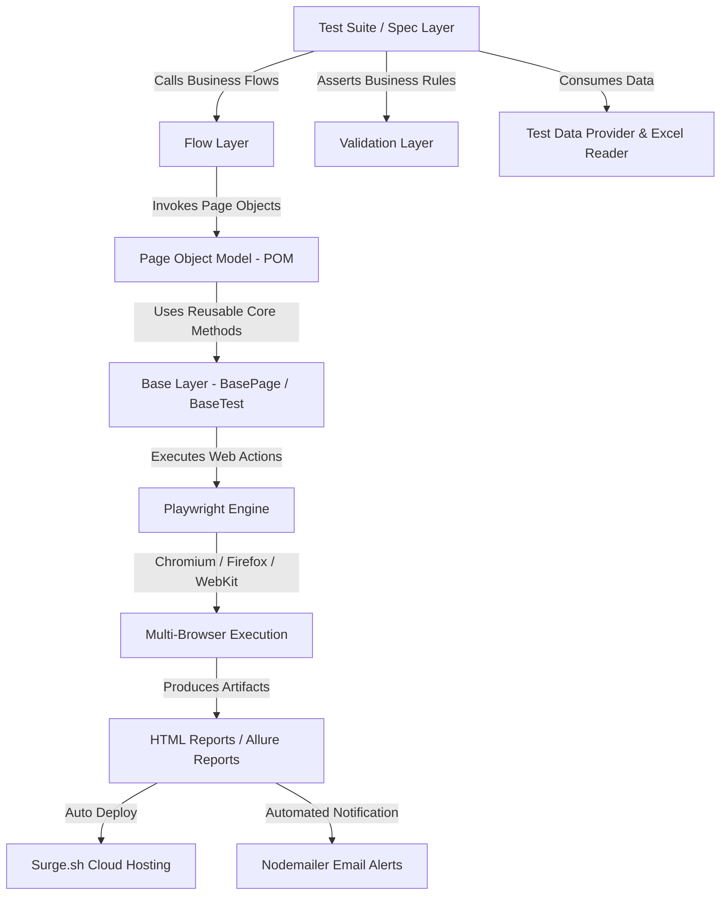

# 🚀 Hi Busy Enterprise Automation Framework

<p align="center">
  
  
  
  
  
  
</p>

An enterprise-grade, multi-role end-to-end test automation framework built with **Playwright**, **JavaScript**, and **Allure Reporting** for the **Hi Busy Subscription Management System**. Designed for high maintainability, parallel execution, cross-browser compatibility, and seamless CI/CD integration.

---

## 📑 Table of Contents

- [Overview & Architecture](#-overview--architecture)
- [Key Features](#-key-features)
- [Multi-Role Access Matrix](#-multi-role-access-matrix)
- [Folder Structure](#-folder-structure)
- [Prerequisites & Installation](#-prerequisites--installation)
- [Configuration (.env)](#-configuration-env)
- [Test Execution Guide](#-test-execution-guide)
- [Analytical Reports Automation](#-analytical-reports-automation)
- [Reporting & Cloud Dashboard](#-reporting--cloud-dashboard)
- [Data-Driven Testing](#-data-driven-testing)
- [Locator Strategy](#-locator-strategy)
- [Security & Best Practices](#-security--best-practices)

---

## 🏛️ Overview & Architecture

The framework is architected following a multi-tier modular pattern:



### Layer Breakdown
- **Test Layer (`tests/`)**: High-level test orchestrations using `@playwright/test`. Clean, readable, and free of direct raw locators.
- **Flow Layer (`flows/`)**: End-to-end business workflows combining multiple page actions (e.g., `LoginFlow`, `PartnerFlow`).
- **Page Object Model (`pages/` & `page_objects/`)**: Encapsulates UI elements, locators, and action methods per screen.
- **Base Layer (`base/`)**: Common driver actions, explicit waits, logging, screenshots, and assertions (`BasePage`, `BaseAssertions`).
- **Validation Layer (`validations/`)**: Reusable assertions guaranteeing business logic and data integrity.
- **Test Data Layer (`test-data/` & `providers/`)**: Excel/JSON parsers supporting dynamic and data-driven testing.

---

## ✨ Key Features

- **Multi-Role Testing**: Built-in support for `Admin`, `Busy Team`, `Channel Partner`, and `Reseller` personas with authenticated state storage.
- **Analytical Reports Suite**: Automated end-to-end navigation, filtering, date-range selection, background queuing, and Excel download verification for:
  - Due Renewals
  - Expired Renewals
  - New Activations
  - Inactive Reports
  - Transfer In Reports
- **Cloud & Email Reporting**: Single-command execution that generates Allure reports, deploys them to **Surge.sh**, and emails comprehensive HTML summary reports to stakeholders.
- **Parallel Execution**: Optimized multi-worker parallel execution with retries and auto-capturing of screenshots/traces on failures.
- **Resilient Locators**: Web-first assertions, ARIA role selectors, and resilient Material UI handling.
- **Zero-Credential Leakage**: Strict environment segregation via `.env` and `.env.example` to ensure passwords and PII are never committed.

---

## 👥 Multi-Role Access Matrix

| Role | Responsibilities & Test Scope | Default Dashboard |
| :--- | :--- | :--- |
| **Admin** | Full system governance, partner management, master configurations | `/admin/dashboard` |
| **Busy Team** | User management, subscriptions, partner impersonation, license operations | `/busy_team/dashboard` |
| **Channel Partner (CP)**| Order creation, renewals, license allocations, customer list | `/partner/dashboard` |
| **Reseller** | Reseller tier license management and purchase operations | `/reseller/dashboard` |

---

## 📂 Folder Structure

```
hi-busy-automation/
├── base/                   # Base classes (BasePage, BaseTest, BaseAssertions)
├── config/                 # Environment, constants, URLs, and role configs
├── factories/              # Test data factories (UserFactory)
├── fixtures/               # Playwright fixtures (auth, role, base)
├── flows/                  # Reusable business workflows (LoginFlow, PartnerFlow)
├── locators_inventory/     # Documented UI locator inventories
├── page_objects/           # Component actions & locator objects
├── pages/                  # Page Object Model implementations
│   ├── Login/              # Login Page Objects
│   ├── Partner/            # Partner Management Page Objects
│   ├── Reports/            # Analytical Reports Page Objects
│   └── User/               # User Administration Page Objects
├── providers/              # Test data providers & Excel bridges
├── scripts/                # Framework run scripts (Allure, emailer, runners)
├── test-data/              # Test datasets (Excel templates, reports config)
│   └── reports/            # Report filter & validation configs
├── tests/                  # End-to-End test suites
│   ├── All_reports/        # CP and Busy Team report tests
│   ├── login/              # Login & authentication test suite
│   ├── partner/            # Channel partner & reseller workflows
│   ├── purchase/           # Subscription purchase & renewal tests
│   ├── reports/            # Analytical reports test suite
│   │   ├── CP_analytical_report/  # Due Renewals
│   │   ├── expired_renewals/      # Expired Renewals
│   │   ├── inactive/              # Inactive Reports
│   │   ├── new_activations/       # New Activations
│   │   └── transfer_in/           # Transfer In
│   └── wallet/             # Wallet balance & limit validation
├── utils/                  # Reusable utilities (Logger, Date, DB, Excel, etc.)
├── validations/            # Custom validation & business assertion classes
├── .env.example            # Environment configuration template
├── .gitignore              # Enterprise ignore rules (secrets, reports, scratch)
├── package.json            # Dependencies & npm scripts
└── playwright.config.js    # Playwright runner configuration
```

---

## 🛠️ Prerequisites & Installation

### Prerequisites
- **Node.js**: v18+ (LTS recommended)
- **npm**: v8+

### Setup Instructions

```bash
# 1. Clone repository
git clone https://github.com/ankitkashyap-lang/Hi_busy_automation-.git
cd Hi_busy_automation-

# 2. Install dependencies
npm install

# 3. Install Playwright browser binaries
npx playwright install chromium firefox webkit

# 4. Configure environment variables
cp .env.example .env
```

---

## ⚙️ Configuration (.env)

Edit `.env` with your QA environment credentials and parameters:

```env
# Application Base URL
ENVIRONMENT=qa
BASE_URL=https://hiqa1.pooraa.net/
QA1_BASE_URL=https://hiqa1.pooraa.net/
QA2_BASE_URL=https://hiqa2.pooraa.net/

# Test User Credentials
ADMIN_EMAIL=your_admin_email@busy.in
ADMIN_PASSWORD=your_password
BUSY_TEAM_EMAIL=your_busy_team_email@busy.in
BUSY_TEAM_PASSWORD=your_password
CHANNEL_PARTNER_EMAIL=your_cp_email@busy.in
CHANNEL_PARTNER_PASSWORD=your_password

# Test Runner Settings
BROWSER=chromium
HEADLESS=true
WORKERS=4
TIMEOUT=30000

# Reporting & Notifications
QA1_REPORT_EMAIL=qa-team@busy.in
SURGE_DOMAIN=busy-playwright-allure.surge.sh
SMTP_SERVER=smtp.example.com
SMTP_PORT=587
SMTP_USER=smtp_user
SMTP_PASSWORD=smtp_password
```

---

## 🧪 Test Execution Guide

### By Tag / Test Type

```bash
# Smoke Tests
npm run test:smoke

# Sanity Tests
npm run test:sanity

# Regression Suite
npm run test:regression

# Data-Driven Tests
npm run test:data-driven
```

### By Module

```bash
# Login Tests
npm run test:login

# Partner Management Tests
npm run test:partner

# Subscription & Purchase Tests
npm run test:purchase

# All Analytical Reports
npm run test:reports
```

### Execution Modes & Browsers

```bash
# Headed mode (Interactive browser window)
npm run test:headed

# Debug mode (Playwright Inspector)
npm run test:debug

# Cross-browser runs
npm run test:chromium
npm run test:firefox
npm run test:webkit
npm run test:all-browsers

# Traces and Videos
npm run test:trace
npm run test:video
```

---

## 📊 Analytical Reports Automation

Each analytical report features isolated specs covering:
1. **Navigation & UI**: Menu expansion, page loading, table columns, drawer state.
2. **Filters & Validation**: Product tabs, date pickers, dropdown selects, negative validations.
3. **Queue & Download**: Background queue submission, status polling, and `.xlsx` download validation.

```bash
# Due Renewals
npm run test:duerenewals

# Expired Renewals
npm run test:expiredrenewals

# New Activations
npm run test:newactivations

# Inactive Reports
npm run test:inactive

# Transfer In
npm run test:transferin
```

---

## 📈 Reporting & Cloud Dashboard

### 1. Local HTML Report
```bash
npm run report
```
Launches the built-in Playwright HTML report at `http://localhost:9323`.

### 2. Allure Report
```bash
# Generate Allure report
npm run allure:generate

# Open Allure report dashboard
npm run allure:open

# Clean previous Allure results
npm run allure:clean
```

### 3. Automated Run, Cloud Deploy & Email Alert
```bash
# Run tests on QA1, generate Allure, publish to Surge.sh & dispatch email
npm run test:report:qa1

# Run tests on QA2, generate Allure, publish to Surge.sh & dispatch email
npm run test:report:qa2
```

---

## 📁 Data-Driven Testing

Test data can be maintained via Excel (`.xlsx`) or generated on-demand using framework scripts:

```bash
# Generate sample login dataset
npm run generate:login-data

# Generate partner test dataset
npm run generate:partner-data

# Generate purchase test dataset
npm run generate:purchase-data
```

Excel row execution is controlled by the `Execute = Yes/No` flag and priority flags (`P0`, `P1`, `P2`).

---

## 🎯 Locator Strategy

To ensure zero flaky tests across UI releases, locators follow this priority order:

1. `data-testid` / `id` (e.g., `#usr`, `#pwd`)
2. `getByRole` (e.g., `page.getByRole('button', { name: 'Login' })`)
3. `getByLabel` / `getByPlaceholder` (e.g., `page.getByPlaceholder('Search')`)
4. `getByText` with exact matching
5. Stable structural CSS
6. ❌ Avoid dynamic classes (like Material UI auto-generated `jss123` or `.css-xyz`)

---

## 🔒 Security & Best Practices

- **Zero-Credential Commitment**: `.env` is ignored by Git. Only safe `.env.example` templates are tracked.
- **Session Protection**: `storageState/` cookies and JSON tokens are never committed.
- **Isolated Tests**: Every test initializes clean or independently managed context to prevent cross-test pollution.
- **Smart Auto-Waiting**: Playwright's native auto-waiting is prioritized over hardcoded timeouts.

---

## 👨‍💻 Maintainers & Credits

- **Author**: Ankit Kashyap ([@ankitkashyap-lang](https://github.com/ankitkashyap-lang))
- **Team**: QA Automation Team, Busy Infotech Pvt. Ltd.
- **License**: ISC
